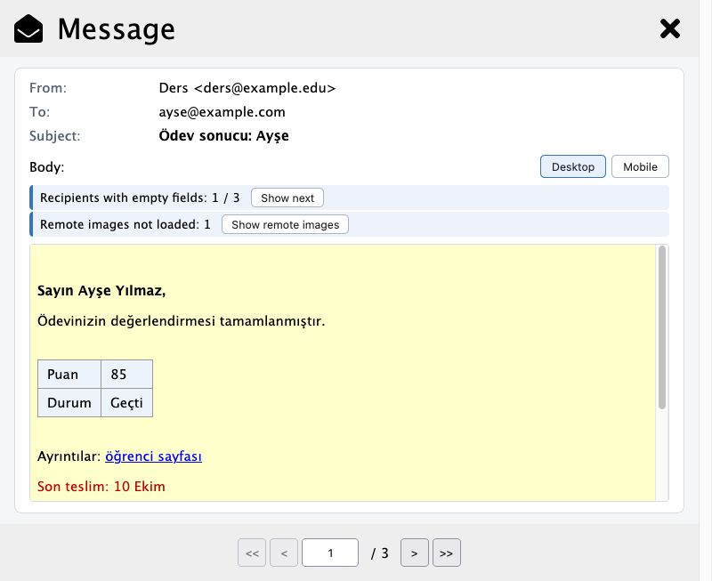

# Mail Merge (HTML Preview)

A Thunderbird add-on built on **[Mail Merge](https://addons.thunderbird.net/addon/mail-merge/) 11.6.1 by Alexander Bergmann**.
Its **Message** tab shows each merged email the way the recipient will see it. Tables, colors and Word formatting are rendered, not printed as HTML source. It also warns about merge fields that will come out empty.

Data sources, the `{{field}}` syntax, sending, Send Later and drafts work exactly as in Mail Merge 11.6.1.



> This is not an official Mail Merge release and is not affiliated with its author.
> It uses the same add-on ID as Mail Merge, so installing it **replaces** an installed Mail Merge.
> All of Mail Merge's settings are kept.

---

## Built on

| Project | Author | License | Role here |
|---|---|---|---|
| [Mail Merge 11.6.1](https://addons.thunderbird.net/addon/mail-merge/) | Alexander Bergmann | GPL-3.0 | **The foundation.** All of Mail Merge 11.6.1 is included: data sources, field substitution, sending, Send Later and drafts. This add-on adds the rendered Message preview on top of it. |
| [MailMergeP](https://github.com/siefkenj/MailMergeP) | siefkenj | GPL-3.0 | **Design reference.** We took ideas from it: a rendered preview, a compact address card above the message, the "1 / N" counter, and navigation buttons that switch off at the ends of the list. No code was copied. MailMergeP is itself based on Mail Merge. |
| [SheetJS](https://sheetjs.com) `xlsx` 0.20.3 | SheetJS LLC | Apache-2.0 | Bundled by Mail Merge for reading CSV and spreadsheets; included as Mail Merge ships it. |
| [Font Awesome Free](https://fontawesome.com) 5.15.4 icons | Fonticons, Inc. (@fontawesome) | CC BY 4.0 | Mail Merge's icons; each SVG keeps its attribution. |

Full license texts and attributions are in [`addon/THIRD-PARTY-NOTICES.txt`](addon/THIRD-PARTY-NOTICES.txt), which ships inside the `.xpi`.

## Why it was needed

### The preview showed code, not the message

Mail Merge's **Message** tab is where you check every personalized message before sending. For an HTML message it printed the body's source:

```
<!DOCTYPE html><html><head><meta http-equiv="content-type" content="text/html; charset=UTF-8"><style>.score { …
```

With a plain one-paragraph email you can still read through that. With a real template you cannot: a table per recipient, colored text, or a letter pasted from Word. The only way to see the result was to save drafts or send test messages to yourself.

The case that started this was sending each student their own grade table. Before mailing a whole class, you want to see that each number sits in the right cell and that nobody gets an empty row.

### Why not just use MailMergeP?

MailMergeP already has a rendered preview, but it is a different add-on:

- It uses the Nunjucks template engine, not Mail Merge's `{{name|value|then|else}}` conditions, so existing templates would have to be rewritten.
- Its preview copies only the message `<body>` into the add-on page, so styles in `<head>` and colors set on `<body>` are lost.

Keeping Mail Merge and replacing only its preview kept every existing template and setting working.

### Empty fields go out silently

Mail Merge replaces a field it cannot find with nothing. Three common mistakes all turn into a gap in every email:

- a typo such as `{{Nmae}}`
- a case mismatch such as `{{ad}}` for column `Ad`
- bold or color formatting that slipped inside the braces, such as ``, which the HTML editor makes easy to do

The preview now points these out before anything is sent.

## Features

- **Rendered preview.** The merged message is shown in a sandboxed frame, recipient by recipient. Styles in `<head>`, body colors and conditional fields are all applied. The view can be switched between desktop width and a 390 px phone width; on the phone width, images are scaled to fit.
- **Field check** above the preview:
  - *Not found in the data*: fields that do not exist in the CSV, JSON or XLSX columns, with a suggestion when formatting slipped inside the braces (` → {{Soyad}}`).
  - *Empty for this recipient*: fields with no value for the recipient on screen (e.g. "Sayın Mehmet ,").
  - *Recipients with empty fields: 3 / 120*: the count over the whole list, with **Show next** to jump to the next one.
  - *Not replaced*: `{{…}}` expressions that will reach the recipient literally, e.g. a malformed condition.
- **Links** look like links. Hovering shows the personalized address (`…?no=1001`). Clicking never leaves the preview.
- **Images.** Embedded images are shown. Remote images load only after **Show remote images** is clicked, and the choice is forgotten when the Message tab closes. Images the preview cannot reach (`cid:`, local files) appear as a dashed box of the same size.
- **Plain-text warning.** If the delivery format is *plain text only*, the preview says recipients will not see the formatting.
- **Navigation.** A "1 / N" counter is shown, and First/Previous/Next/Last switch off at the ends of the list. Empty Cc, Bcc and Reply rows are hidden. The preview fills the window, so there is only one scroll bar.
- **Dark mode.** Mail Merge darkens its dialog by inverting the whole page, which also inverted the message. The dialog still goes dark, but the message keeps the colors recipients will see.

Texts are in English and Turkish; other languages fall back to English.

## How it is built on Mail Merge

`addon/` contains Mail Merge 11.6.1 in full, together with the preview.

| File | Role |
|---|---|
| `content/html-preview.js` | The preview: builds, cleans and renders each message and runs the field check. |
| `content/dialog.html`, `content/style.css` | Mail Merge's dialog. The Message tab holds the preview frame, its toolbar and the "1 / N" counter. |
| `content/dialog.js` | Mail Merge's dialog logic. Its Message tab section hands each merged message to the preview. |
| `manifest.json`, `_locales/` | Name "Mail Merge (HTML Preview)", version 11.6.1.3. English and Turkish texts for the preview. |
| `THIRD-PARTY-NOTICES.txt` | Licenses and attributions of Mail Merge, SheetJS and Font Awesome. |
| everything else | Mail Merge 11.6.1 as published. |

Several parts come from Mail Merge 11.6.1 exactly as published: permissions, the experiment API, `background.js`, the options page, and all merge, data-source and sending code. `build.py` checks this against SHA-256 fingerprints of the Mail Merge 11.6.1 files every time it builds.

## Security

The message is untrusted HTML shown inside a privileged add-on page, so it is isolated in three layers:

1. **Cleaning.** The HTML is cleaned in an inert document, where nothing runs or loads. Removed: scripts, frames, objects, `meta`, `link`, `base`, event-handler attributes and form actions.
2. **Sandbox.** It is rendered in an `<iframe sandbox="">` with no scripts and no access to the add-on.
3. **Content Security Policy.** Every network load is blocked, except remote images after the user asks for them. Links cannot navigate away.

The preview never changes the message that gets sent.

## Install

1. Download `mail-merge-html-preview-<version>.xpi` from [Releases](https://github.com/ilker-golcuk/thunderbird-addons/releases).
2. In Thunderbird open **Add-ons and Themes → Extensions → ⚙ → Install Add-on From File…** and pick the file. Close any open Mail Merge window first.
3. Open the add-on's details and set **Allow automatic updates** to **Off**. Otherwise the next official Mail Merge update replaces this build and the preview goes back to HTML source.

To go back to the original, install Mail Merge again from [addons.thunderbird.net](https://addons.thunderbird.net/addon/mail-merge/).

Requires Thunderbird 128–158, the same range as Mail Merge 11.6.1. Tested on Thunderbird 157.0.1 on macOS.

## Build and test

```bash
npm install                 # puppeteer-core only; no browser is downloaded
npm run build               # → dist/mail-merge-html-preview-<version>.xpi
npm test                    # Firefox (+ Chromium if present), light and dark mode
npm run test:thunderbird    # end to end in a real Thunderbird
```

- **`npm test`** loads the real `dialog.html`, `style.css`, `dialog.js` and `html-preview.js` into a page. It uses Mail Merge's real field substitution. It runs in Firefox 157, which shares its Gecko engine with Thunderbird 157, and in Chromium. It checks:
  - styles, body colors and conditional fields
  - links and images
  - the field check
  - navigation and quick switching between recipients
  - widths and layout
  - dark mode, measured on screen pixels
  - plain text
  - the empty list
  - a hostile message: no script runs, no request leaves, a link click stays in the preview
- **`npm run test:thunderbird`** starts Thunderbird with a throwaway profile; your own profile is not used. It then:
  1. installs the built XPI
  2. opens a compose window and clicks the Mail Merge button
  3. loads a CSV file and checks the Message preview in light and dark mode
  4. runs a real merge into *Local Folders/Drafts*

  Thunderbird's WebDriver BiDi only reaches its own windows, so this test drives the add-on page through a frame script. A future Thunderbird may need changes to the test.

Paths default to macOS app locations. `FIREFOX_PATH`, `CHROME_PATH` and `THUNDERBIRD_PATH` override them.

## Limitations

- Images attached with `cid:` and images that point to local files are shown as placeholders.
- The phone width is a 390 px approximation, not a specific phone or mail app.
- The "not found in the data" check needs a fixed set of columns, so it runs for CSV, JSON and XLSX only. Address-book sources get only the empty-field check.

## License

GPL-3.0, the license of Mail Merge. See [`../LICENSE`](../LICENSE) and [`addon/license.txt`](addon/license.txt). Bundled third-party components keep their own licenses: SheetJS under Apache-2.0 and Font Awesome icons under CC BY 4.0. See [`addon/THIRD-PARTY-NOTICES.txt`](addon/THIRD-PARTY-NOTICES.txt).

This add-on is based on Mail Merge 11.6.1 by Alexander Bergmann. The rendered Message preview and field check were added on 2026-10-04.

---

## Türkçe özet

Bu eklenti, Alexander Bergmann'ın Thunderbird eklentisi **Mail Merge 11.6.1** üzerine kurulmuştur. Mail Merge'nin **Message** ekranı, HTML iletilerde iletinin kendisi yerine HTML kaynak kodunu gösteriyordu. Bu yüzden tablo, renk ya da Word biçimlendirmesi içeren bir şablonun her alıcıya nasıl gideceği gönderimden önce görülemiyordu. Örneğin her öğrenciye kendi not tablosunu gönderirken bu kontrol yapılamıyordu.

Bu sürüm iletiyi alıcının göreceği biçimde, güvenli ve yalıtılmış bir çerçevede gösterir. Ayrıca veride olmayan, boş kalan ya da yerine konamayan alanları gönderimden önce uyarır.

Önizleme tasarımında **MailMergeP**'den (siefkenj) fikir alınmış, kod alınmamıştır. Şablon dili, veri kaynakları ve gönderim Mail Merge 11.6.1'deki gibi çalışır.
